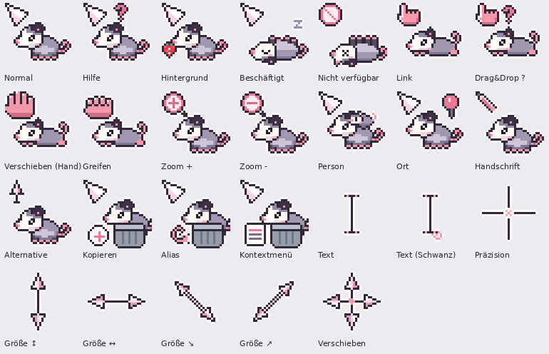

# 🐾 Opossum-Mauszeiger



Ein niedliches, animiertes Pixel-Art-Mauszeigerset mit einem kleinen Opossum,
für **Windows 10/11** und **Linux (GNOME und andere Desktops mit Xcursor)**.

Der eigentliche Zeiger bleibt klein und präzise – ein drehender rosa Pfeil oder
ein Opossum-Pfötchen. Daneben macht das Opossum passend zur Situation etwas:
es schnuppert, schläft auf dem Rücken, stellt sich tot, wenn etwas nicht geht,
knabbert an einer Erdbeere oder guckt aus einer Mülltonne.

## ✨ Enthalten

| Zeiger | Opossum macht … |
|---|---|
| Normal | schnuppert am drehenden Pfeil |
| Hilfe | legt den Kopf schief, ein „?“ wippt |
| Arbeiten im Hintergrund | knabbert eine Erdbeere |
| Beschäftigt | schläft auf dem Rücken, „Z“ steigt auf |
| Nicht verfügbar | stellt sich tot 🙃 |
| Link | liegt auf dem Bauch, Pfötchen zeigt |
| Person | trägt ein Baby auf dem Rücken |
| Ort · Handschrift · Alternative | Stecknadel · Stift · Pfeil nach oben |
| Kopieren · Verknüpfung · Kontextmenü | guckt aus der Mülltonne |
| Zoom ± · Greifen · Drag & Drop | Lupe · Pfötchen · „?“ |
| Text, Präzision, Größe ändern, Verschieben | schlicht in Opossum-Farben |

- 26 Zeiger, die meisten animiert
- Größen 32, 48, 64 und 96 px (scharfe Pixel, nur ganzzahlig skaliert)
- Windows: alle 17 Zeigerrollen belegt
- Linux: alle Freedesktop-Namen plus über 100 alte X11-Namen

## 📥 Download

Unter **[Releases](../../releases)** die passende Datei herunterladen:

- `Opossum_Zeiger_Windows.zip` – für Windows 10/11
- `Opossum_Zeiger_Linux.tar.gz` – für GNOME / Linux

## 🪟 Installation Windows 10/11

1. `Opossum_Zeiger_Windows.zip` entpacken.
2. Rechtsklick auf **`install.inf`** → **Installieren**
   (Windows 11: Rechtsklick → „Weitere Optionen anzeigen“ → „Installieren“).
3. Einstellungen → Bluetooth und Geräte → Maus → **Weitere Mauseinstellungen** →
   Reiter **Zeiger** → Schema **Opossum** wählen → **Übernehmen**.

Entfernen: im Reiter „Zeiger“ ein anderes Schema wählen, „Opossum“ markieren → „Löschen“.

## 🐧 Installation Linux (GNOME)

```bash
tar -xzf Opossum_Zeiger_Linux.tar.gz
cd Opossum_Zeiger_Linux
./install_gnome.sh
```

Das Theme wird nach `~/.local/share/icons/Opossum` kopiert und aktiviert.
Alternativ in **GNOME Optimierungen** (gnome-tweaks) → Erscheinungsbild → Zeiger auswählen.

Größe ändern:
```bash
gsettings set org.gnome.desktop.interface cursor-size 48   # 24 = Standard, 48, 96
```

Entfernen: `./uninstall_gnome.sh`

Andere Desktops (KDE, XFCE, Cinnamon …): den Ordner `Opossum` nach
`~/.local/share/icons/` kopieren und in den Systemeinstellungen als Zeigerthema wählen.

## 🛠️ Selbst anpassen

Alle Zeiger sind als Pixel-Raster in Python beschrieben (Ordner `Quellen/`).
Mit `python3 build_pkg.py` (benötigt Pillow) werden beide Pakete neu erzeugt.

## 📜 Lizenz

[CC BY-NC 4.0](LICENSE) – frei nutzen, teilen und verändern mit Namensnennung,
**aber nicht kommerziell**.

---

### English

Cute animated pixel-art opossum cursors for **Windows 10/11** and **Linux (GNOME / Xcursor)**.
Download from **Releases**. Windows: right-click `install.inf` → Install, then pick the
scheme “Opossum” in Mouse settings → Pointers. Linux: run `./install_gnome.sh`.
License: CC BY-NC 4.0 (no commercial use).
